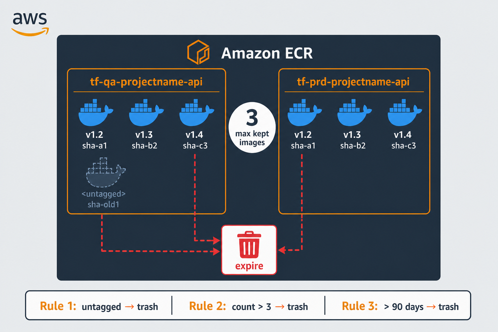

# 📦 ECR lifecycle + ECS
ECR repos such as `tf-qa-projectname-api` and `tf-prd-projectname-api` accumulate images over time. **Lifecycle policies** expire old images by **age / count / tag**.

> ⚠️ **ECR does not know what ECS is running.** A lifecycle policy can expire an image that a running task or the active task definition still references. Tasks already running keep working, but the next **task replacement, scale-out, or rollback** fails with `CannotPullContainerError`. Size the rules so the deployed image is never a candidate for expiry.



## 📜 Two rules (default)
| Priority | Rule |
| --- | --- |
| **1** | Expire **untagged** images after **1 day** |
| **2** | Keep only the **last 3** images (`imageCountMoreThan`) |

Lifecycle removes by **age / count / tag**, not by CVE or by usage. Fix the image, deploy a new task definition, then older images roll off as new ones are pushed.

### Why there is no "older than N days" rule
An age rule on tagged images (`sinceImagePushed` + `tagStatus: any`) deletes the **running** image of any service that hasn't been redeployed in N days — the classic "prod hasn't changed in 3 months and now can't scale" incident. A count rule only expires images when **newer** ones are pushed, so the deployed one stays. Also, a rule with `tagStatus: any` must have the **highest** `rulePriority`, so a policy can hold only one such rule.

## 🛠️ Apply with Terraform
1. Edit **[`terraform/repositories.tf`](./terraform/repositories.tf)** — set `project_name` and/or the `repository_names` list (repos must already exist in AWS).
2. Run:

```bash
cd terraform
terraform init
terraform apply
```

That applies both rules to every repo in the list. Optional: `terraform.tfvars` for `aws_region` or rule numbers only — **repo names stay in `repositories.tf`**.

Details: [`terraform/README.md`](./terraform/README.md).

## ✅ Keep the deployed image safe
- **Size the count** — `image_count_more_than` ≥ deployed image + how many versions back you want to roll back to. If several environments share one repo, count all of their live images.
- **One repo per environment** (`tf-qa-*`, `tf-prd-*`) — QA pushes don't push prod images out of the window.
- **Immutable, unique tags** (git SHA, build number) — never redeploy `latest`; enable tag immutability on the repo.
- **Dry-run first** — use *Preview* in the ECR console (lifecycle policy preview) before applying to prod repos.
- **If it already happened** — rebuild/push the image (or redeploy a recent tag) and update the service; running tasks are unaffected until they are replaced.

## 🔗 Related
- [`complete-infrastructure/`](../complete-infrastructure/) — ECS + ECR in the stack
- [ECR lifecycle policies](https://docs.aws.amazon.com/AmazonECR/latest/userguide/LifecyclePolicies.html)
